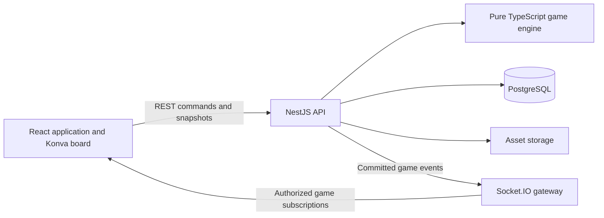

# Specification 0001: Wargame Web Service

Date: 2026-10-22  
Status: Proposed; product assumptions require confirmation before dependent implementation  
Related document: [Product backlog](../product-backlog.md)

Document role: Original product requirements and proposed architecture. For the implemented stack and present state, start with [current project context](0002-project-context.md), then [T01 changes](0003-t01-workspace.md) and [T02 changes](0004-t02-local-database.md). Proposed features below are not completion claims.

Decision update (2026-10-22): The project owner confirmed Konva with react-konva for the battle map. Administrator uploads provide image assets; Konva provides their interactive board presentation. The remaining stack recommendations and product assumptions retain their proposed status. See [development guidelines](../../AGENTS.md) for the requirement to explain important technical decisions during development.

Implementation update (2026-10-22): T01 establishes the pnpm workspace, React/Vite shell, NestJS health endpoint and shared contract. See [workspace foundation decision](../decisions/0001-workspace-foundation.md) and [verification evidence](../verification/t01-workspace.md). Database integration, gameplay and production deployment remain planned work.

Visual decision (2026-10-22): The owner approved the T01 palette and style for subsequent UI. See [interface style](../design/interface-style.md); its CSS tokens should be reused across forms, content pages, administration and board controls.

Database update (2026-10-22): T02 adds local PostgreSQL 18.6, Prisma 7.10.1, a domain-free baseline migration, validated private environment settings and database readiness. See [local database decision](../decisions/0002-local-database.md) and [T02 verification](../verification/t02-local-database.md). Account and game schemas remain feature work; no hosting service is introduced.

## 1. Purpose and scope

Build a browser service for playing a turn-based wargame together. Players use a shared battle map and the service enforces agreed movement and combat rules. Administrators maintain game content and manage access.

Confirmed requirements from the initial request:

| ID | Requirement |
| --- | --- |
| R01 | Simple registration with a username and password. |
| R02 | Login and authorization. |
| R03 | Two account roles: administrator and player. |
| R04 | A rules page containing text and images. |
| R05 | An interactive battle map with units movable within their movement allowance. |
| R06 | An administrator can advance turns. |
| R07 | Players can advance turns by mutual agreement. |
| R08 | Hovering over a unit reveals its properties after a delay. |
| R09 | A damage and casualty calculator accounts for all relevant properties of the units involved. |
| R10 | An administration area supports creating/uploading and editing units. |
| R11 | Administrators can add maps. |
| R12 | Administrators can edit rules. |
| R13 | Administrators can manage player permissions. |

The request does not define the actual wargame rules. This specification defines software boundaries and proposed defaults, not a new ruleset. The service must not claim correct movement or combat calculations until representative examples and rule coverage have been approved.

## 2. Product assumptions and boundaries

Confirmed context (2026-10-22): This is a hobby service for the owner's group of friends, with no current plan for a commercial launch. Low recurring cost and manageable maintenance are design constraints. The initial deployment should fit on one host without mandatory paid application services. An exact monthly spending ceiling and the group's size remain undecided; no hosting price or resource guarantee is implied.

Proposed MVP assumptions:

- Private games with explicitly assigned participants; one account may join several games.
- Desktop-first interface; touch and keyboard alternatives exist for essential controls and unit inspection.
- Two sides initially, with potentially several players on each side. The roster and turn sequence are fixed while a game is active.
- Account role is global; game membership, side, and unit ownership are separate permissions. New accounts receive the player role and no automatic access to private games.
- Rules pages are available to signed-in users initially; public access is a product decision.
- Uploaded maps are raster backgrounds with explicit board calibration and movement metadata. Uploading an image does not infer terrain or obstacles.
- Unit definitions are reusable templates; deployed units are separate instances with position and current combat state.
- Rules, map definitions, and unit definitions are versioned. Active games retain their selected versions.
- The calculator first provides a preview; changing persisted casualties is a separate, explicitly authorized operation.

Deferred unless requested: matchmaking, chat, AI opponents, native mobile apps, fog of war, line of sight, scenario scripting, simultaneous orders, undo/replay UI, public spectators, and arbitrary executable formulas uploaded by administrators. Any of these that the actual rules require must be promoted into scope before claiming a complete rules implementation. Email, social login, and email-based password recovery are outside the initial username/password flow; administrator-assisted resets are proposed.

## 3. Proposed technology stack

Use a TypeScript monorepo and a modular backend. Exact dependency versions will be chosen together at implementation kickoff, checked for compatibility, and pinned in the lockfile. Use a supported Node.js LTS release and supported PostgreSQL release rather than assuming today's newest major versions are compatible.

| Layer | Choice | Why it fits | Cost or limitation |
| --- | --- | --- | --- |
| Language and workspace | TypeScript, pnpm workspaces | Share API contracts and deterministic game logic across browser and server; keep one language for a small team. | Runtime validation is still necessary; types do not validate network inputs. |
| Web application | React + Vite + React Router | The core experience is a stateful browser board and admin forms. A client application keeps the rendering model straightforward. | Separate backend and routing deployment; no server rendering by default. |
| Board | Konva + react-konva | Declarative canvas scene graph, pointer events, image layers, pan/zoom, unit selection and movement previews. | Canvas needs a parallel DOM inspector and keyboard controls for accessibility; performance must be measured. |
| Forms and state | React Hook Form, Zod, TanStack Query; local React state for board interaction | Validated forms, typed request schemas, and server-data caching without a large global store. | Cached data must be reconciled using server revisions. |
| Backend | NestJS with REST endpoints and a Socket.IO gateway | Modules, dependency injection, guards, and validation organize accounts, content, games, and realtime delivery. | More structure than a minimal HTTP server; gateway authentication must be implemented deliberately. |
| Persistence | PostgreSQL + Prisma ORM and reviewed SQL migrations | Relational membership, revisions, and transactional game commands fit a relational database. ORM improves routine CRUD and typed access. | Row locks and advanced constraints may need parameterized SQL; ORM major versions require compatibility checks. |
| Authentication | Opaque server-side sessions in PostgreSQL; maintained Argon2id password library | Simple revocable login sessions fit username/password accounts and immediate access changes. | Requires session cleanup, CSRF protection, and session lookup; do not build cryptographic primitives. |
| Assets | Persistent local filesystem in development and initial deployment; S3-compatible storage deferred | One host can store map, unit, and rules images without a separate storage service. Keep metadata and access policy in PostgreSQL. | Host disk is a single failure point; enforce disk limits and copy backups off-host. Revisit object storage only when needed. |
| Rules content | Structured rich text with image references, e.g. Tiptap | Administrators can edit illustrated rules without writing HTML. | Sanitize and validate on the server; restrict supported content nodes. |
| Tests | Vitest for shared rules and frontend; backend integration tests against PostgreSQL; Playwright for browser flows | Deterministic rule examples, real concurrency checks, and two-session browser tests cover the main failure modes. | Browser tests require seeded content and isolated databases. |
| Deployment | One modest VPS with Docker Compose, reverse proxy with TLS, one backend instance and local PostgreSQL | Keep hosting and maintenance concentrated on one machine; serve static frontend assets through the proxy. | One host has downtime during failures/maintenance; operations and off-host backups remain necessary. Size and price require measurement and a budget ceiling. |

Next.js is a reasonable alternative if server-rendered public content becomes central, but the current application is dominated by authenticated board interaction. A dedicated NestJS process also gives realtime connections a clear lifecycle. Django or FastAPI would be reasonable with an established Python team; TypeScript is preferred here to share game-engine code. SVG could serve a small board; canvas is the proposed starting point for many interactive tokens. Neither Kubernetes, Redis, microservices, nor a full event-sourcing system is necessary for the first release.

Implementation should introduce libraries when their feature slice needs them, rather than installing the entire proposed stack upfront. NestJS modules remain in one backend deployment. Prisma is a CRUD and migration tool, not the source of game-rule enforcement. Socket.IO improves update delivery; turn-based correctness still rests on database transactions and revisions. An initial board prototype must validate Konva against the representative map and unit count before substantial editor work.

Serve the SPA, `/api`, and `/socket.io` through one HTTPS origin. Proxy API and WebSocket traffic to NestJS and configure SPA route fallback for browser navigation. Same-origin deployment simplifies session cookies and avoids unnecessary cross-origin authentication configuration. Store uploads outside the public web root in a persistent mounted directory; authorize private reads through the backend. PostgreSQL data also uses persistent storage. Container replacement must not erase either dataset. If object storage is added later, use private buckets and authorized delivery or short-lived signed URLs.

Budget baseline: no managed database, separate object-storage server, Redis, Kubernetes, paid monitoring, subscription authentication, CDN, or high-availability replicas are required for launch. Use local structured logs with rotation and simple health checks. Count hosting, optional domain registration, backup storage, and operator time when comparing deployment options. Free hosting tiers are not assumed to support persistent files and long-lived connections; verify restrictions before selecting one. Self-hosting on an existing machine is an alternative if its availability, connectivity and maintenance are acceptable. No provider has been selected or paid service authorized.

These choices are recommendations, not existing implementation. Relevant primary documentation supports the framework capabilities:

- [React TypeScript support](https://react.dev/learn/typescript) and [Vite project templates](https://vite.dev/guide/).
- [React Konva scene components and events](https://konvajs.org/docs/react/index.html).
- [NestJS WebSocket gateways](https://docs.nestjs.com/websockets/gateways) and [gateway guards](https://docs.nestjs.com/websockets/guards).
- [Socket.IO rooms](https://socket.io/docs/v4/rooms/) for game-specific broadcasts; rooms are delivery groups, not authorization boundaries.
- [Prisma transactions](https://www.prisma.io/docs/orm/fundamentals/transactions) and [PostgreSQL concurrency control](https://www.postgresql.org/docs/current/mvcc.html) for transactional state changes. Confirm the chosen Prisma version's transaction API before implementation.
- [Docker persistent volumes](https://docs.docker.com/engine/storage/volumes/) for data that must survive container replacement; persistent storage is not itself an off-host backup.

## 4. Architecture and module boundaries



Suggested repository layout:

```text
apps/web/              React pages, board, forms, DOM inspector
apps/api/              NestJS modules, REST, realtime gateway
packages/contracts/    DTO schemas, error codes, event contracts
packages/game-engine/  Pure movement and combat functions
docs/                  Product and architecture documents
infra/                 Local deployment and backup configuration
```

Backend modules: identity, permissions, assets, rules, unit catalog, map catalog, games, movement, turns, combat, audit, and realtime. Controllers accept validated requests; application services check permissions and own transactions; the engine evaluates rules without database or UI dependencies. The browser may run the same engine for previews, but the server always recomputes authoritative results.

Use REST for writes and state snapshots and Socket.IO for change notifications. This avoids maintaining separate command implementations for HTTP and sockets. All subscribers authenticate and pass a membership check before joining a game room. Logout, account suspension, and permission changes revoke relevant subscriptions; each subsequent read or command checks current permissions.

## 5. Authorization and account lifecycle

| Action | Player | Administrator |
| --- | --- | --- |
| Read rules | Yes, when signed in | Yes |
| View a private game | Assigned game member | Yes; access is audited where appropriate |
| Move a unit | Own assigned unit, permitted active side/phase | Setup placement; any active-game override must be separately defined and logged |
| Inspect visible units and preview combat | Within assigned game and visibility policy | Yes |
| Vote to advance turn | Eligible member of that game | If participating as a player |
| Force turn advance | No | Yes, with recorded reason |
| Edit catalogs, maps, rules | No | Yes |
| Assign game access, sides, unit ownership | No | Yes |
| Change account roles or suspend accounts | No | Yes, with audit record |

Proposed account policy: normalized case-insensitive unique usernames, passwords of at least 12 characters with passphrases supported, generic login errors, rate limits on login/registration, Argon2id hashes, random session tokens stored as hashes, and HttpOnly/Secure/SameSite cookies over TLS. Validate request origin and protect mutations against CSRF. Decide session idle and absolute expiry before implementing identity.

Provision the first administrator through an explicit one-time deployment command, never public registration. Prevent removal or suspension of the last active administrator. Password resets issue a short-lived one-time credential and invalidate existing sessions; do not disclose stored passwords. Suspension invalidates sessions immediately. Authorization is enforced server-side for every object and command, not only by hiding UI elements.

## 6. Domain model

| Entity | Essential responsibilities |
| --- | --- |
| User / Session | Identity, password hash, global role, account status; revocable session token hash and expiry. |
| Asset | Storage key, validated media type, dimensions, size, uploader, and references. |
| RulesetVersion | Structured illustrated rules plus a reference to the supported engine configuration/version. Prose editing alone cannot change engine behavior. |
| UnitDefinition / UnitDefinitionVersion | Stable catalog identity and immutable published properties: movement and combat stats, typed abilities, image, validation schema version. |
| MapDefinition / MapVersion | Background asset, coordinate calibration, topology, dimensions, terrain and blocked areas if required. |
| Game | Lifecycle, pinned content versions, game revision, current turn/phase, active side, engine version. |
| GameMember / Side | User membership, side assignment and participation status. |
| UnitInstance | Game, definition version, controlling player/side, position, remaining movement, strength/health, statuses. |
| Turn / TurnConsent | Turn identifier and eligible voter snapshot; one consent per eligible user and turn. |
| CombatResolution | Participants, canonical inputs, rule version, random roll if applicable, result, actor and application status. |
| GameEvent / AuditEntry | Ordered game changes and administrative history; excludes secrets and password material. |

Use foreign keys and uniqueness constraints for membership, consent, and command deduplication. Keep common stats typed; use schema-validated structured data for abilities rather than arbitrary untyped properties. Archive referenced definitions instead of deleting historical data. Editing a definition produces a new version and does not silently alter deployed units.

## 7. Game lifecycle and board behavior

Proposed lifecycle: `draft -> active -> finished`, with an optional administrator-controlled `paused` state. During draft setup, the administrator selects a map and rules version, assigns sides and units, and chooses the first active side. Activation requires valid membership, placement, and supported rules. Finished games are read-only.

The board displays a background, units, selection, available movement, and turn status. Store logical map coordinates independently of screen pixels; zoom and resizing must not change distances. Provide pan, zoom, selection, movement preview and a clear invalid-move explanation. Show properties after a proposed 500 ms hover delay, with equivalent click, focus and touch inspection. The DOM inspector exposes text, current state, and abilities accessibly.

Movement requires explicit answers about square/hex/free movement, scale, distance metric, diagonal cost, terrain, collision, stacking, and whether path length or straight-line distance controls legality. A provisional simple grid adapter can be built after topology selection; do not assume that Euclidean radius satisfies the actual rules.

A move command identifies the unit, proposed path/destination, expected game revision, and unique command ID. The server validates actor, game status, active side, ownership, map bounds, traversability, occupancy, path cost, remaining allowance, and relevant status effects. In one transaction it updates position and spent allowance, increments the game revision, and appends an event. Invalid moves leave all state unchanged. Reset allowances only at the boundary defined by the chosen turn rules. Admin setup placement is distinct from a legal player move.

## 8. Turn advancement and mutual agreement

The request permits an administrator to advance turns and players to do so by mutual agreement. The exact meaning of a turn and the eligible voting group remain open.

Proposed default: all active player participants on both sides must consent to advance the current side's turn. The first consent freezes ordinary game mutations while voting is pending, so the last vote cannot approve a state that changed unnoticed. A player can withdraw their consent; ordinary play resumes when all consents have been withdrawn. The UI must clearly explain this pause. Administrator force-advance remains available with a reason.

- Votes refer to a specific turn ID and roster version; unique constraints prevent duplicate votes.
- Disconnection does not count as consent and does not remove a voter. There is no automatic timeout advance in the MVP.
- Final consent and administrator advance use the same transactional turn-transition service.
- Lock the game row and validate expected revision before writing; concurrent final votes and admin requests can advance the turn only once.
- Transition to the next configured side/phase, reset applicable allowances and statuses, clear consents, increment revision, and emit one event after commit.
- Changing membership during an active game requires pausing, explicit roster revision, and invalidating pending consents. No silent exclusion of an unresponsive player.
- If an eligible participant is suspended or removed, pause affected active games and invalidate pending consents atomically with their game access change. Do not auto-consent or auto-advance. An administrator must explicitly repair the roster and resume play. Use a consistent lock order for commands that affect several games.

This voting policy is a proposal. If the desired system uses round-level voting, active-side-only agreement, captains, or continued play while voting, revise this section before implementing turns.

## 9. Combat calculation

Implement a pure, versioned rules engine with an explicit typed input/output contract. Required inputs may include attacker and defender stats, unit counts, weapons, armor, statuses, abilities, terrain, range, and facing; only the actual supplied rules determine which are relevant. Support more than two participants only if the rules require it.

The calculator must show participating unit versions, relevant modifiers, intermediate steps, rounding, final damage and casualties, and any missing or unsupported input. Unknown abilities must produce an explicit unsupported-rule error rather than a guessed result. A scenario preview does not mutate a game. If dice are involved, distinguish expected outcomes from sampled rolls; define rounding, casualty allocation, caps, simultaneous damage, and death/status rules using worked examples.

Optional extension, pending scope confirmation: an explicit apply-result action for an authorized active-side player. The calculator alone satisfies the currently requested scope. If application is included, the server reloads current participants, checks range/phase/action eligibility, recomputes results, generates and records any random rolls server-side, and atomically updates survivors/statuses. A stale preview must be rejected or refreshed before application. A command ID makes retries safe. Randomness is never accepted as authoritative client input.

Coverage gate: create a matrix mapping every supported stat and ability to a formula step and a golden test case, including combinations and boundary cases. Textual rule changes that affect gameplay require a corresponding engine/configuration revision and tests before publication as supported rules. The combat formula is intentionally unspecified until the rules are supplied.

## 10. API, consistency, and reconnects

Illustrative resource groups: `/auth`, `/users`, `/rulesets`, `/units`, `/maps`, `/assets`, and `/games`. Game commands include move, consent, withdrawal, force-advance, combat preview, and combat application. Final endpoint contracts belong to implementation design.

Each persisted game command carries `commandId` and `expectedRevision`. Execute permission checks and state-dependent validation inside a transaction that serializes mutations on the game row. Return structured errors such as `FORBIDDEN`, `STALE_REVISION`, `INVALID_MOVE`, `VOTING_PENDING`, and `UNSUPPORTED_RULE`. Store deduplication records and results in the same transaction; repeated IDs with different payloads are rejected.

Deduplication keys are scoped by actor and game, with a canonical payload fingerprint covering command type, target, revision and inputs. Authenticate and verify current access before returning any stored result. Under the game lock, check for a completed matching command before checking the expected revision: a retry after a lost acknowledgment must return the original result even though that successful command advanced the revision. Only new commands undergo fresh revision and gameplay validation. Persist all game changes, results and events in that same transaction. Define deduplication retention before launch; retain records for at least the game's writable lifetime. All permission/membership writes that affect game legality must participate in the same game-lock protocol so revocation and moves have a definite order.

Persist the event before commit; broadcast only after commit. Events carry `gameId`, monotonic revision, event type, and permitted payload. Clients ignore duplicates, detect revision gaps, and fetch an authoritative snapshot on reconnect or mismatch. A lightweight revision check on reconnect, tab focus, and periodic active-game refresh also repairs a missed final broadcast. The database remains the source of truth. Optimistic drag previews are allowed, but the client commits displayed state only after acknowledgment and can restore rejected previews.

Start with one backend instance. Multi-instance delivery would need a shared Socket.IO adapter and reliable event distribution; add an outbox worker if stronger notification guarantees become necessary. Do not treat Socket.IO recovery as durable storage or assume delivery is exactly once.

## 11. Content administration and assets

Admin screens cover unit definitions and image upload, map creation and calibration, illustrated rules editing, and player permissions. Validate required fields and preview content before publishing. Archive catalog entries that are in use. Rules editor output must use allowed nodes and sanitized rendering; uploaded content cannot execute scripts.

Proposed upload policy: PNG/JPEG/WebP only initially, validated by decoded content with pixel and byte limits; reject SVG and executable formats initially. Store generated object keys, not user-controlled paths. Strip unnecessary metadata and use image processing limits. Asset reads respect game/content access. Track references and delete only unreferenced assets after a retention interval. The exact upload limits and storage quota require operational sizing.

## 12. Quality, operations, and validation

Provisional hobby-scale acceptance envelope, to validate with the actual group: one active game, 2–8 connected players and up to 200 units on the board. Multiple saved games remain supported; simultaneous active games are not an initial sizing requirement. Target responsive command handling and smooth pan/zoom on an agreed desktop device, with backend command processing p95 below 500 ms under the representative load (excluding network transit). These are planning targets, not measured capabilities or confirmed group size. Increase capacity only when actual usage calls for it.

- Persist all accepted moves, turn transitions, combat applications, and content edits across process restarts.
- Support current stable desktop Chrome, Firefox, and Edge; agree on the final browser matrix before release.
- Provide visible loading, disconnected, conflict, empty, and validation-error states. Keyboard users can inspect/select units and choose a destination through DOM controls.
- Add request IDs, structured logs with rotation and health/readiness endpoints. Inspect command latency, rejection rates and disconnects during validation; no separate monitoring platform is required. Exclude credentials and tokens from logs.
- Back up PostgreSQL and assets together, retaining the references needed to restore them consistently. Proposed baseline: daily backups with seven daily copies on a separate device or storage service, plus a backup before migrations. Test restoration. Up to 24 hours of progress may be lost under a daily schedule; recovery is manual when the owner is available, with no four-hour recovery commitment or commercial uptime guarantee. Confirm retention and the off-host destination against the budget before deployment.
- Test the pure engine with approved examples, API access control with cross-game attempts, and transactional races with real PostgreSQL. Browser tests use two player sessions and an administrator session.
- Release gates include registration/login/logout, role enforcement, safe content publishing, a legal/illegal move pair, agreed and forced turn advancement, supported combat cases, reconnect convergence, and backup restoration.

## 13. Delivery plan and dependencies

1. Resolve game-rule questions and collect a small representative ruleset, two unit definitions, one calibrated map, and worked movement/combat examples.
2. Establish workspace, identity, authorization, migrations, and asset storage.
3. Add admin catalogs, illustrated rules, and draft game setup with pinned versions.
4. Deliver a shared board with authoritative movement and reconnect behavior.
5. Add transactional turn control and mutual agreement.
6. Deliver verified combat previews; add result application only if separately included in scope.
7. Complete security, accessibility, performance, deployment, and restore verification.

These increments are sequenced in the backlog. No calendar estimate is reliable until the rule model and sample content are available.

## 14. Decisions needed before dependent work

| Question | Proposed starting point | Blocks |
| --- | --- | --- |
| What are the source rules and representative combat examples? | Supply existing rules; build an explicit supported-rule matrix. | Correct stats schema and combat implementation. |
| Square grid, hex grid, or free movement; what scale and distance rules? | No default until a sample map and movement rules exist. | Map calibration, pathfinding and movement legality. |
| What is a turn: player, side, phase, or round? How does allowance reset? | Alternating side turns, fixed roster. | Turn and movement state transitions. |
| Who must agree to a turn switch, and may play continue during consent? | All active participants, freeze on first consent. | Consent behavior and UI. |
| Should calculator results also update units? Who may apply? | Calculator preview is required; persistent application is an optional extension. | Optional combat write permissions and gameplay integration. |
| Is combat deterministic or dice-based; what are rounding and casualty rules? | No invented formula; use approved examples. | Combat engine and audit format. |
| How many sides/players, and who owns or shares each unit? | Two sides, multiple players, explicit unit owner. | Setup and authorization model. |
| Are terrain, stacking, line of sight, hidden information or facing required? | Add only those required by actual rules. | Movement, visibility and combat scope. |
| What may administrators override in active games? | Force turns; setup placement only outside active play. | Override workflows and audit requirements. |
| Can users self-register publicly; who can see rules and games? | Self-registration, private game membership, signed-in rules. | Access and abuse controls. |
| What UI language, monthly spending ceiling, available host, backup destination, and group size? | Documentation in English; UI language undecided; budget hobby service for friends on one host, with local uploads and off-host backups. | UI copy, final capacity targets and deployment selection. |

Record answers as revisions of this specification or focused follow-up specifications before building dependent behavior. Foundational work can proceed independently once implementation is requested.
