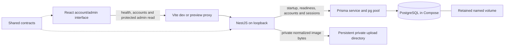

# Specification 0002: Current Project Context

Updated: 2026-10-25

Status: Current implemented-state overview after T01–T10 and verification. B02/M0, M1 accounts/roles and B06 image-storage foundation are complete; catalogs, game-specific permissions and gameplay remain later work.

## 1. Purpose and document boundaries

Web Wargame is a browser service for the owner's group of friends to play a turn-based tabletop wargame. There is no current commercial launch plan. Favor low recurring cost, one host and straightforward maintenance. The owner is learning alongside development: explain important technical decisions in Russian while keeping repository documentation in English.

This document is the entry point for current technical context. [Specification 0001](0001-project-specification.md) retains the original requirements, proposed architecture and open gameplay questions. It is not evidence that all planned capabilities exist. The [product backlog](../product-backlog.md) defines feature scope; the [implementation backlog](../implementation-backlog.md) owns task status. [T01](0003-t01-workspace.md), [T02](0004-t02-local-database.md), [T03](0006-t03-repeatable-checks.md), [T04](0007-t04-local-workflow.md), [T05](0008-t05-registration.md), [T06](0009-t06-sessions.md), [T07](0010-t07-account-interface.md), [T08](0011-t08-administrator-access.md), [T09](0012-t09-private-image-storage.md) and [T10](0013-t10-asset-lifecycle.md) describe individual increments. Reviews record findings; verification reports record checks actually performed.

## 2. Product scope and present state

| Capability | Present state |
| --- | --- |
| Browser shell and real server request | Introduced in T01; T07 adds the Russian account interface and retains a compact health indicator with retry. |
| Local persistence and configuration | Implemented in T02: PostgreSQL, Prisma, migrations, private local settings, startup validation and readiness. |
| Repeatable checks and repository CI | Implemented and published in T03, including the reviewed runtime correction. Clean frozen installation and all local lint/type/build/test checks pass under Node 22.22.3. Remote CI status remains unverified after publication. |
| Documented local workflow | Completed in T04: clean-checkout setup, browser/API demonstration, normal Windows terminal stop/restart, built preview and retained database state were verified. |
| Player registration API | Implemented in T05: persisted users, normalized unique usernames, Argon2id password hashes, strict validation and bounded attempts/work. Always creates a player, without a session or game access. |
| Login/current-user/logout API | Implemented in T06: PostgreSQL-backed revocable sessions, server expiry, protected cookies, Origin/CSRF controls and login quotas. |
| Account forms | Implemented in T07: Russian registration/login, signed-in shell, refresh restoration, clear errors, expiry and logout; phone-width forms retain the approved visual style. |
| Administrator/player permissions | T08 implements reusable server session/role guards, first-admin bootstrap, last-admin protection and a protected landing page. Account management/suspension remain T11; game-specific access remains T17. |
| Private image storage and lifecycle | T09 upload/read APIs plus T10 archive/restore, internal references and manual guarded cleanup. Existing references/readability survive archive; no browser upload/cleanup screen or HTTP delete/reference-owner API. |
| Illustrated rules and admin catalogs | Planned, T12–T16. T10 supplies the reference registry, but actual owners, rules editor and catalog UI do not exist. |
| Shared board, unit inspection and movement | Planned, T18–T23/T28–T29. Konva is confirmed but not installed. |
| Admin and mutual-consent turn changes | Planned, T24–T27. The turn and voting rules still require input. |
| Damage/casualty calculator | Planned, T30–T32. No formulas or unit abilities are implemented. |
| Applying combat losses | Optional T39, outside the required calculator scope. |
| Production deployment and off-host backups | Planned, T35–T38. No production service has been deployed. |

T01–T10, the foundation parent B02/M0, account parents B03/B04, milestone M1 and B06 image-storage foundation are Done. T10 implements verified image references/cleanup on 2026-10-25. T09 adds image-storage APIs on 2026-10-24–25. T04's runtime checks occurred on 2026-10-23; completion documentation was finalized on 2026-10-24. T05–T08 were implemented/verified on 2026-10-24. Public registration, ASCII username policy and seven-day absolute / 24-hour idle sessions are owner-confirmed. T08 completes global administrator access; B05 remains partial until game-object authorization in T17. Catalog administration and gameplay are not implemented. Private games, two sides, voting freeze and the proposed 2–8-player capacity envelope remain assumptions rather than approved gameplay rules.

## 3. Stack and reasons

| Layer | Implemented choice | Reason and limitation |
| --- | --- | --- |
| Runtime | Node.js `^22.22.3` or `^24.15.0`; reference `.node-version` 22.22.3 | Corrected after the old 22.22.0 reference failed strict engine validation. Clean frozen installation and full checks passed with pnpm itself and child commands both on portable 22.22.3. All locked engine declarations accept the range; this is not a full execution matrix. The owner's system Node was not replaced. |
| Language | TypeScript 5.9.3, strict settings | Share types and eventually pure game logic. Runtime data/configuration still needs validation. |
| Workspace | pnpm 11.25.0, four private packages, committed lockfile | Local `workspace:*` links and ordered builds avoid separate package releases. No Nx/Turborepo is required. |
| Browser | React/React DOM 19.3.1, Vite 8.3.5, React plugin 6.1.2 | Account and administrator views with native fetch, an in-memory session controller and same-origin Web Locks for cookie-changing actions. T08 uses normal links to `/admin` with the existing Vite fallback. No router, form/cache library or new runtime dependency is needed. |
| API | NestJS 12.2.0, local CLI 12.0.10, Express adapter | One structured backend with lifecycle hooks and room for feature modules. No global CLI or second backend service is needed. |
| Database | Official PostgreSQL 18.6 bookworm image | Transactions and relational game/account data fit the future model. One local database avoids a managed-service bill. |
| Persistence tools | Prisma CLI/client/pg adapter 7.10.1 | Versioned migrations and generated ESM client. SQL probes work without introducing dummy domain models. PostgreSQL driver dependencies are pinned transitively by the lockfile. |
| Configuration | Zod 4.6.7 and Node's built-in environment loader | Validate database/port, exact `PUBLIC_ORIGIN` and private-upload paths/limits; external HTTP is rejected. Errors omit supplied values. No dotenv dependency is needed. |
| Password storage | `argon2` 0.45.1, Argon2id, 19 MiB/two iterations/parallelism one | Library-generated salt and 32-byte encoded hash; registration hashing/login verification share two concurrent operations. Explicit native install permission; T05 fresh Windows/Linux Node 22.22.3 operations passed. No recurring service cost. Measure on the eventual host. |
| Sessions | PostgreSQL rows and Node built-in random/SHA-256/HMAC operations | 32-byte opaque cookie bearer, stored digest only, session-bound CSRF and seven-day/24-hour expiry. No Redis, JWT package or paid service. Each authenticated check reaches the database for revocation/current user data. |
| Images | Sharp 0.35.5, private local filesystem and PostgreSQL Asset/reference metadata | Full strict decode/re-encode and durable pending byte reservations. T10 adds archive state, internal references, seven-day cleanup retention and non-expiring filesystem activity markers. No new dependency, storage-service bill or automatic cleanup schedule. |
| Styling | Plain CSS with shared semantic tokens and system fonts | Preserve the owner's approved style without a UI-kit subscription or external font service. |
| Current tests | Node's built-in test runner, real HTTP/PostgreSQL integration and manual browser inspection | 142 database-free cases: 108 API and 34 browser-client/controller; reviewed T10 Windows passed 141 with one file-symlink permission skip and initial Linux passed all 142 with reused locked dependencies. The reviewed database suite passed 77 cases including lifecycle/cleanup, queued revocation and controlled races. Earlier browser evidence remains separately scoped below; this is not the full agreed browser/device matrix. |
| Static lint / CI | ESLint 10.13.0, `@eslint/js` 10.0.1, typescript-eslint 8.72.0, globals 17.13.0, React Hooks plugin 7.1.1; one GitHub Actions job | Exact development-only versions and committed lockfile. Recommended JS/TS correctness rules and fundamental Hooks checks; not a formatter or type-aware lint suite. CI consumes the corrected Node reference and has temporary PostgreSQL; no remote CI success yet. |

Confirmed future board technology: Konva/react-konva. Proposed future tools include React Router, React Hook Form, TanStack Query, rich-text editing and Socket.IO; introduce them with their actual feature and explain the decision. Vitest/Playwright remain possible later testing choices, not installed infrastructure. Argon2id and server-side sessions are implemented in T05/T06; private local asset storage is implemented in T09. Redis, microservices, Kubernetes, paid monitoring, managed databases and object storage are not launch prerequisites.

## 4. Architecture now

`apps/web` owns UI; `apps/api` owns configuration, HTTP, accounts/sessions, permission guards, database access and private image storage; `packages/contracts` owns shared health/readiness, registration/session, admin-overview and asset-metadata contracts; `packages/game-engine` is an empty buildable rules entry point. There is no browser-to-database connection. All code uses ESM; Node packages use `NodeNext`, while the browser uses bundler module resolution. Generated Prisma TypeScript lives under ignored `apps/api/src/generated/prisma` and is built into API output. The application factory installs registration/login limits and session/admin request protection before bounded JSON parsing and validates UTF-8 bytes before decoding. Raw image POST bypasses JSON parsing; its session/role/CSRF guards precede bounded body consumption. Executable and integration tests share this setup.

T07 keeps the public user, CSRF value and session deadlines only in memory; the browser manages the HttpOnly bearer cookie. Reload restores the session from the API before showing account content. A shared exclusive Web Lock serializes login/logout across same-origin tabs until response reconciliation completes; unsupported browsers receive an explicit compatibility message. A marker-only BroadcastChannel and visible-page/focus checks refresh other tabs without transmitting credentials. There is no authenticated heartbeat: an expiry timer clears stale UI locally, and the server remains authoritative. Session-changing requests are not automatically aborted or retried because an uncertain response can still change the cookie. Current-user GET has a ten-second bound. See [T07 decisions](0010-t07-account-interface.md).

T08 reuses current PostgreSQL-backed sessions through `SessionGuard`, then `RolesGuard` checks the database role for protected endpoints. Session data and no-store headers apply to failures too; future guarded mutations require trusted Origin, the request marker and the session-bound CSRF value. The browser calls the protected overview before showing the administrator panel and discards private results when the identity changes or a cookie-changing action begins. Cached roles only hide/show navigation. Normal `/admin` links avoid a router dependency. See [T08](0011-t08-administrator-access.md).

The planned architecture is server-authoritative: future moves, votes and combat application must be checked and committed by the server. Sharing an engine with browser previews will not make browser results authoritative. Current code has no game command service, revisions, event log, sockets or game-object authorization yet.

T09 uses one upload pipeline per instance, generated UUID files outside served web directories and complete decode/re-encode before persistence. Default limits are 10 MiB incoming/stored bytes, 8192 pixels per side, 24 million pixels, 1 GiB disk budget and 64 MiB free-space reserve. A short advisory-locked transaction explicitly selects Read Committed isolation, then checks current authority, actual files and pending reservations before committing `ready=false` metadata. This query must see reservations committed before lock acquisition, independently of the database's default isolation. The complete file is then exclusively written/synced before `ready=true`; pending assets are unreadable and count their entire reserved size even without a complete file. This avoids a lock-lifetime race with slow filesystem writes and transaction timeouts. Orphans remain counted; cleanup/references are T10. All writers must share database/root/limits, and initial deployment remains one host/instance. [T09](0012-t09-private-image-storage.md) records choices, native timeout and JPEG-lossiness limits.

T10 adds `AssetReference` bindings keyed by owner kind/UUID/slot, a restricted FK, readiness/archive target checks and last-reference timestamps maintained by SQL triggers. Future catalogs must save actual owners and registry bindings in the same transaction; no catalog or public owner-reference API is implied. Archive rejects new bindings while preserving existing ones and reads. Archive/restore mutations recheck current session/expiry/ADMIN role inside the transaction after acquiring the shared asset lock; upload reuses that authority helper. Manual cleanup requires archive/no references plus seven days since both archive and last detach; pending/orphan retention is seven days. A non-expiring maintenance file and writer admission markers fence filesystem work, including startup probes. Maintenance refuses any writer marker; an old marker needs verified offline process/container shutdown before exact-file removal. Cleanup deletes revalidated metadata in Read Committed first, then unlinks only after confirmed commit. This fences late pending finalization; failed unlinks leave actual orphan bytes counted. Only generated regular files can be removed, in bounded batches without recursive deletion. See [T10](0013-t10-asset-lifecycle.md).

## 5. Interfaces and local operation

| Interface | Contract |
| --- | --- |
| `GET /api/health` | HTTP 200: `{ "status": "ok", "service": "wargame-api" }`. Process liveness only. |
| `GET /api/ready` | Queries the database; HTTP 200: `{ "status": "ready", "database": "ok" }`; HTTP 503 with a generic message when the query fails. |
| `POST /api/auth/register` | Strict JSON `{username,password}` → 201 with public player ID/name/role/timestamp. 400 field/JSON errors, 409 duplicate, 413 oversized, 415 unsupported media/encoding, 429 attempt limit with `Retry-After`, 503 capacity/persistence failure. No session cookie. Full [T05 contract](0008-t05-registration.md#api-contract). |
| `POST /api/auth/login` | Trusted Origin + `X-Wargame-Request: 1`, strict JSON credentials → 200/public user, CSRF, deadlines and fresh HttpOnly cookie. Generic 401, bounded 429 and sanitized 503. |
| `GET /api/auth/me` | Cookie + custom request header → current public user/CSRF/deadlines; 401 if invalid/expired. Idle renewal is atomic/monotonic and no response changes cookies. |
| `POST /api/auth/logout` | Cookie + trusted Origin/custom header + `X-CSRF-Token` → revoke current session then 204/expired cookie. Protection failures 403; failed revocation cannot claim success. Full [T06 contract](0009-t06-sessions.md#3-resulting-interfaces). |
| `GET /api/admin/overview` | Current cookie + custom request header → 200 `{status:'ready',user:{id,username,role:'ADMIN'}}` only after server session/role checks; 401 unauthenticated, 403 `ACCESS_DENIED` for a player, sanitized 503 when unavailable. No-store and no Set-Cookie. |
| `POST /api/admin/assets` | Current ADMIN cookie, exact trusted Origin, request marker and session CSRF; raw static PNG/JPEG/WebP → 201 `{asset}`. Byte/pixel failures 413, invalid/unsupported image 400/415, body timeout 408, busy 429, capacity 507, unavailable 503. No automatic retry. |
| `GET /api/admin/assets/:id` and `/:id/content` | Current ADMIN cookie and request marker → ready metadata or normalized streamed bytes. Unknown/pending IDs 404; anonymous/player access fails. Private/no-store and nosniff; no static public URL. Future browser views use fetch/blob URLs. |
| `GET /api/admin/assets/:id/lifecycle` | Current ADMIN cookie/request marker → `{asset,archivedAt,unreferencedSince,referenceCount}`; existing metadata response remains compatible. |
| `POST /api/admin/assets/:id/archive` and `/restore` | Current ADMIN session + Origin/request marker/CSRF → lifecycle response. Idempotent archive preserves its original time; restore allows new bindings again. |
| Browser requests | Same-origin registration/session requests with runtime response validation and local Russian errors. Current-user GET is bounded to ten seconds; login/logout use serialization and uncertain-outcome reconciliation rather than automatic mutation retry. The health indicator retains a five-second timeout/retry and does not display readiness. |

The API validates settings, successfully queries PostgreSQL and probes private-storage access before listening. Readiness continues to probe PostgreSQL; it is not a disk-capacity probe. Default loopback ports: API 3000, frontend development 5173, built preview 4173 and PostgreSQL 5432. `API_PORT` configures the API and Vite proxy target. Private database/upload settings are not injected into frontend assets.

The root ignored `.env` is created by `pnpm env:init`; it contains a random local password. The initializer preserves an existing file. Existing process variables override file values. `.env.example` contains only names, nonsecret defaults and blank secret fields. `PUBLIC_ORIGIN` defaults to `http://127.0.0.1:5173`; preview selects port 4173 before API startup. Only loopback HTTP or an HTTPS public origin is accepted, and HTTPS selects Secure host-prefixed cookies. `pnpm db:up` starts the database; `pnpm db:migrate` applies committed history; `pnpm dev` starts the applications/watchers. `pnpm db:down` independently stops the database project and retains its volume. Full commands and troubleshooting live in [README](../../README.md).

The named volume `webwargame-local_postgres-data` is mounted at `/var/lib/postgresql`. Its persistence was tested across container replacement; that is not a backup or disk-failure recovery guarantee. pnpm's separate shared dependency store is also outside the source tree; it is a package cache, not application data. Git tracks manifests/lockfile, not installed packages, generated code, local credentials or volumes.

Uploads default to the repository's ignored `.local/uploads`, independent of process working directory. Set absolute `UPLOAD_DIRECTORY` on persistent storage when moving checkouts/deploying containers; mount the same directory/volume after replacement. Files and database metadata must be backed up together (T37). All `UPLOAD_*` ranges and Unix modes/Windows ACL implications are in [README](../../README.md#private-image-storage). `pnpm assets:cleanup` previews; `--apply --limit 25` explicitly applies a bounded batch. Activity-control files are at most 1024 bytes and excluded from image quota. Offline recovery and the exact database/directory pairing are documented in [README](../../README.md#image-references-archive-and-cleanup-t10). There is no automatic schedule or production container/deployment configuration yet.

T04 documents the complete first-setup/daily/update/preview workflow and optional second-checkout isolation with a stable `COMPOSE_PROJECT_NAME` plus matching published database/URL ports. An ordinary second directory is not database isolation. The optional `db:verify` utility currently fixes the default Compose project and must not be run against an isolated second-checkout setup. Its limitation is explicit in README; the default application/database behavior is unchanged.

## 6. Data, visual style and checks

The Prisma schema contains `UserRole` (`PLAYER`, `ADMIN`), `User`, `Session`, singleton `AdministratorGuard`, `Asset` with readiness/archive/unreferenced timestamps, and `AssetReference` with kinds `UNIT`/`MAP`/`RULES`, owner UUID, slot and restricted asset FK. All six migrations are applied locally; earlier migrations are preserved. Asset uploader and referenced-asset deletion are restricted. Registration always writes `PLAYER`. Reference-owner rows are not catalog entities; no game/unit/map table exists yet.

The operator-only `pnpm admin:bootstrap --username <existing-user>` command promotes the first administrator and revokes that user's old sessions in one transaction. It accepts no password, creates no user and refuses another player after an administrator exists; an already-admin target is an idempotent no-op. The owner's main database was left without users or an appointed administrator. A statement trigger updates the guard row before every User insert/update/delete, serializing writes before user row locks. A row trigger then rejects deleting/demoting the last administrator. This small-group tradeoff also covers multi-row changes and concurrent transactions; stricter snapshot isolation rejects stale competing changes. All accounts are currently active; T11 must extend protection when suspension exists. See [T08 rationale](0011-t08-administrator-access.md).

Owner-confirmed registration is public and accepts ASCII Latin letters/digits/`._-` usernames of 3–32 characters, trimmed for surrounding whitespace and case-insensitive for uniqueness. Passwords are 15–128 Unicode code points, with spaces retained and controls/malformed Unicode rejected; no trimming or normalization occurs. Attempt windows allow ten per socket address and 100 globally in 15 minutes; stored addresses and concurrent hashing are bounded. Proxy headers are ignored, so Vite/reverse-proxy users share a socket-address budget. Counters reset on restart and are scoped to one API instance; revisit proxy trust/distribution before deployment changes. See [T05 decisions](0008-t05-registration.md).

T06 login applies separate ten/socket and 100/global attempt budgets plus five/normalized account per 15 minutes, including successful attempts. Unknown/wrong users perform comparable Argon2 work and return the same generic failure. Sessions last at most seven days or 24 hours without successful authenticated API activity. The raw bearer exists only in the host-only HttpOnly/SameSite cookie; CSRF is derived from it using purpose-bound HMAC and cannot replace it. Exact Origin/custom headers and per-session CSRF protect session endpoints; CORS/proxy trust remain disabled. Current-user returns fresh user/role data and never writes cookies; re-login rotates the presented session, while logout deletes it without upsert/resurrection. Cleanup deletes at most 1000 expired rows every 15 minutes. See [T06](0009-t06-sessions.md) for cookie names, transaction/time semantics and limits.

The owner-approved UI uses deep green `#172724`, surface green `#1d302b`, ivory `#f5f0e5`, muted green-grey `#c1cec7` and sand/gold `#d6b67a`. Reuse CSS tokens, serif display headings, system UI fonts, restrained borders and rounded panels. See the [style guide](../design/interface-style.md) for the complete palette, responsive layout and component rules. Do not recolor uploaded maps/unit art to match the UI.

T07 preserves these colors and adds account panels, persistent field labels/hints/errors, keyboard focus, loading states, password visibility and confirmation. Input borders reuse the stronger muted token. The two-column account layout becomes one column below 900 px. The owner confirmed Russian interface copy and current desktop Chrome/Edge/Firefox as primary browsers, with usable account forms on phones. Full phone board play remains an open later decision; the in-app browser checks do not constitute native-phone or three-browser certification.

Foundation verification included frozen installation, type/build checks, ten configuration/startup/local-target tests, one database-network integration test, migration status and opt-in persistence checks. See [T01 evidence](../verification/t01-workspace.md), [T02 evidence](../verification/t02-local-database.md) and the [combined code review](../reviews/0003-t01-t02-code-review.md). Later T05/T06 suites are recorded below. No CI success, production readiness or complete accessibility matrix is claimed.

T03 adds `pnpm lint`, `pnpm test` (the existing configuration suite; build first when run alone) and `pnpm check` (lint → typecheck → build → test). `check` needs neither `.env` nor a running database. It passed in both the main checkout and an isolated credential-free source copy with a separate frozen cached installation. A temporary intentional `string`-to-`number` assignment in that copy made root type checking exit 1 with TS2322; the restored copy passed. See [T03 evidence](../verification/t03-repeatable-checks.md).

T04 repeated the documented workflow in a clean Git clone with both pnpm and its child commands using Node 22.22.3. Cached frozen installation, migrations, root checks/ten tests, browser retry, direct/proxied health and readiness, compiled preview and bounded startup failures passed. Two owner-operated PowerShell development cycles each reached readiness, then Ctrl+C and `Y` left no captured process or listener on ports 3000/5173; no forced cleanup was needed. This closes the earlier normal-terminal verification gap without changing process orchestration. Isolated PostgreSQL stop/start replaced the container while retaining the exact migration record; readiness recovered without restarting the API, and the main database remained separate. See [T04 evidence](../verification/t04-local-workflow.md) for the dated results and limits.

[Review 0004](../reviews/0004-t03-code-review.md), dated 2026-10-23, reproduced the old Node 22.22.0 frozen-install failure and identified why pnpm's separate bundled runtime had masked it locally. The same-day correction raised the reference to 22.22.3 and narrowed supported ranges to match locked dependencies. A new source-only copy with no `.env` or installed dependencies passed frozen installation as its first dependency operation, retained the exact lockfile hash and passed all root checks with ten tests. The child Node and pnpm host runtime were both explicitly verified as 22.22.3. An independent engine audit and fix review found no remaining actionable issue; T03 completion is restored. See [correction evidence](../verification/t03-repeatable-checks.md#6-runtime-review-correction--2026-10-23). After the owner restarted Docker on 2026-10-23, final pre-publication checks under that selected runtime also passed the root suite, clean/idempotent migrations, migration status and one real network-failure test in an isolated local database. The test database was removed and the project schema remained current; [the new evidence](../verification/t03-repeatable-checks.md#7-final-pre-publication-postgresql-check--2026-10-23) is separate from earlier checks.

The [CI workflow](../../.github/workflows/ci.yml) runs the same checks on pushes, pull requests and manual dispatch, then applies migrations twice, inspects migration status and runs the real network-failure test against its own PostgreSQL service. It reads Node/pnpm versions from the repository, uses frozen installation, full action commit SHAs, minimal repository permissions, a timeout and stale-run cancellation. It neither uses production secrets nor deploys. T03 was published to `origin/master` as `f4782e3` with the owner's authorization; an exact-SHA Actions API read returned HTTP 404 without additional account access, so remote CI status remains unverified. See [publication evidence](../verification/t03-repeatable-checks.md#8-owner-authorized-publication--2026-10-23). Docker's Inference manager/socket failure blocked the initial T03 database pass. The owner's same-day retry restored the runtime by preserving its socket-only directory and launching Desktop through the Windows shell; clean/idempotent migrations, status and the real network-failure test then passed against an isolated local database. That temporary database was removed, and the project service remained healthy with current migration history. No reset or image/volume/VM-data deletion was performed; container-replacement persistence was not rerun. Details and recovery limits are in [T03 evidence](../verification/t03-repeatable-checks.md#5-postgresql-retry-and-runtime-recovery--2026-10-22).

T05 introduced fourteen registration/hash/limiter tests, bringing that increment's database-free total to 24. After [Review 0006](../reviews/0006-t05-code-review.md), its database suite ran eleven registration scenarios plus readiness (thirteen reported cases including parent). Fresh credential-free Windows/Linux sources passed frozen installation/root checks before the review correction; the final Windows suites passed after it. Registration persistence, normalized races, strict raw UTF-8 and limits passed. See [T05 evidence](../verification/t05-registration.md). The reviewed T05 commit `25cc824` was subsequently published to origin/master with the owner's authorization; no remote CI success was confirmed.

T06 adds fourteen auth/token/cookie tests and three configuration tests: root `pnpm check` passes 41 tests in the main and fresh credential-free Windows sources under Node 22.22.3/pnpm 11.25.0. A new frozen installation was verified as the fresh copy's first dependency operation. After [Review 0007](../reviews/0007-t06-code-review.md), the final database suite passed 31 cases: seventeen auth scenarios, eleven registration scenarios, their two parents and readiness. A controlled-lock regression reproduced/fixed cleanup deleting a newly renewed session; the outer DELETE now rechecks expiry. Dual expiry, CSRF, cookies, rotation/restart/role reads, logout races, parsing/limits and bounded cleanup also passed. Main migration/status remains current. [T06 evidence](../verification/t06-sessions.md) distinguishes initial fresh-copy results from post-fix checks. CI invokes the expanded suite; no remote CI, new Linux execution or browser account form is claimed.

T07 extends the root suite with `pnpm test:web`. After [Review 0008](../reviews/0008-t07-code-review.md), twelve account-client and fourteen session-controller tests bring the database-free total to 67; the database suite also passed 31 cases. Review corrections preserve cross-tab invalidation through failed queued login, explain unconfirmed registration and wrap long signed-in usernames. Initial browser checks exercised registration and validation/confirmation/duplicate errors, failed and case-insensitive successful login, reload restoration, two-tab logout, forced server expiry and offline recovery. A real iframe harness checked 320/390/768 px layouts; a 128-code-point emoji password registered and logged in by keyboard at 320 px. Post-review long-name checks fit 305/305 usable/scroll pixels in a 320 px viewport. See [T07 evidence](../verification/t07-account-interface.md) for separately scoped initial and reviewed checks. No new dependency, schema, migration, production deployment or remote CI success is included.

T08 adds nine access-guard, eight administrator-bootstrap and eight admin-client tests, bringing that increment's root suite to 92 database-free tests. Its expanded database suite passed 44 reported cases, including twelve T08 scenarios plus their parent. These exercise direct player/anonymous requests, current roles, bootstrap/session revocation, last-admin deletion/demotion, multi-row statements, missing-guard refusal and concurrent READ COMMITTED, REPEATABLE READ and SERIALIZABLE changes. The T06 role fixture now retains a separate administrator to satisfy the new invariant. Main migration deployment, repeat application and status passed with four migrations current. Actual browser checks passed player denial, bootstrap revocation/re-login, administrator reload/navigation, overview error/retry, live role demotion, logout and visual 320 px layout inspection. Disposable browser data was removed; the main database still has no users/sessions or appointed administrator. [T08 evidence](../verification/t08-administrator-access.md) records the checks and the initial fixture failure separately. No new dependency, paid service, production deployment, full browser/device matrix or remote CI success is claimed by T08.

T09 adds two configuration and 24 image/storage cases, bringing the root suite to 118 reported cases (117 pass/one Windows file-symlink skip; all 118 pass on Linux). The expanded HTTP/PostgreSQL suite passed 61 cases. Frozen Linux installation retained the lockfile; an initial Windows-bind-mount run timed out on two existing startup tests, while the same installed source on a Linux volume passed without relaxed deadlines. A real disposable Linux API-container replacement retained a protected image's metadata/session and exact digest through the same upload mount. The fifth main migration applied/reapplied/current checks passed. Independent review corrected a lock-lifetime race using durable pending reservations. Final probes found zero main users/sessions/assets and no disposable databases. [T09 evidence](../verification/t09-private-image-storage.md) records actual checks, cleanup, native-image OpenSSL warning and operational limits. No upload UI, content references, full browser/device matrix, remote CI, backup/restore or production deployment is claimed.

The subsequent owner-requested [T09 review](../reviews/0010-t09-code-review.md) reproduced and corrected quota over-reservation with a Repeatable Read database default. Explicit Read Committed isolation refreshes visibility after waiting for the advisory lock; the controlled regression failed before the fix and passed afterward. Fresh final root checks passed 117 cases/one Windows privilege skip, and the expanded database suite passed all 62 cases. README migration/persistence wording was corrected, with no additional dependency/schema/migration change. Earlier Linux/container evidence was not repeated. Main data and disposable-resource checks remain clean; commit/push is owner-authorized after final checks.

T10 implementation added 24 database-free cases (activity, internal references, CLI and actual filesystem removal), bringing root checks to 142 reported cases: Windows 141 pass/one file-symlink skip and Linux 142/142. Its initial complete real HTTP/PostgreSQL suite passed 76 cases, including fourteen new lifecycle/CLI cases and controlled reference/cleanup and late-finalization races. A failing-before/passing-after regression drove metadata-first pending deletion so late ready updates cannot leave readable rows without files. Migration application/reapplication/status passed with all six current. Root CLI help/preview passed; only disposable fixtures used `--apply`. Main users/sessions/assets/references remained zero, test databases/control markers were removed, and the temporary Linux volume was removed. [T10 verification](../verification/t10-asset-lifecycle.md) keeps this implementation evidence separate from the subsequent review/publication below. No new dependency, browser screen, real catalog owners, deployment, off-host recovery or remote CI is claimed.

The subsequent owner-requested [T10 review](../reviews/0011-t10-code-review.md) reproduced/corrected archive/restore committing after session or role revocation during an asset-lock wait. Lifecycle mutations now use the same current-authority check as upload after acquiring the lock; all four controlled cases failed before the fix and returned 401/403 with unchanged state afterward. Fresh root checks passed 141/one Windows privilege skip and the complete database suite passed 77/77. README's database-fixture overview was corrected without another dependency/schema/migration change. Earlier Linux/removal evidence was not repeated. Commit/push is separately owner-authorized after final checks.

## 7. Constraints and next decisions

- Resolve Q01–Q06 before rule-dependent movement/turn/combat completion: written rules, representative units/maps, geometry, ownership, visibility, turn semantics, voting and worked combat examples.
- Q08 is partially resolved: Russian UI, current desktop Chrome/Edge/Firefox and phone-usable account forms are confirmed. Full phone board play and later browser/device verification remain open for gameplay tasks.
- Q07 registration/session policy is resolved in T05/T06; rules visibility remains open before T14. T09 private storage and T10 lifecycle infrastructure are implemented; T11 account administration is Ready. Actual catalog owners/reference integration remain T12–T14.
- Confirm monthly budget, group size, host and off-host backup destination before deployment; no provider has been selected or paid service authorized.

Maintain this overview with each completed increment, the incremental specification with behavior changes, and the task-status register with linked evidence. Historical reviews/reports remain historical; record follow-up corrections explicitly instead of rewriting past checks as if they were rerun.

## 8. Mandatory documentation maintenance

The owner requires a change specification and an update to this general context after every coherent change. Follow [Specification 0005](0005-development-documentation.md): create a numbered specification for each new task/change, update it through implementation/review, document actual verification, and link it from task completion evidence. Features, fixes, refactors, configuration/dependency/tooling and development-policy changes are included. A task cannot be Done with a missing/stale specification or context; include documentation with source changes when committing.

Latest update (2026-10-25): T10 adds internal asset references, archive/restore, seven-day retention and manually applied guarded cleanup, completing the B06 storage foundation. [Specification 0013](0013-t10-asset-lifecycle.md) and [verification](../verification/t10-asset-lifecycle.md) record the sixth migration, original Windows/Linux checks and real CLI checks. The owner-requested [Review 0011](../reviews/0011-t10-code-review.md) corrected queued archive/restore authority after session/role revocation; a new failing-before/passing-after regression and fresh root/database checks passed 141/one Windows privilege skip and 77/77. Cleanup never age-expires activity markers; offline recovery requires verified stopped owners. Existing image metadata/content remains compatible, while actual catalog owners/UI remain T12–T14. T11 is Ready. No new dependency, paid service, browser screen or deployment is included; T10 commit/push is now explicitly owner-authorized after final checks. [Specification 0005](0005-development-documentation.md) continues to govern documentation maintenance.

T08's owner-requested [Review 0009](../reviews/0009-t08-code-review.md) found no actionable defect and its separately dated fresh root/database runs passed 92/44. Last-administrator protection and the minimal panel remain implemented; the panel conservatively uses its last known session deadline, so future regularly active pages must reconcile deadlines. T08 publication was separately owner-authorized.

The owner-requested [T07 review](../reviews/0008-t07-code-review.md) corrected three reproduced P2 defects: lost cross-tab invalidation during failed login, misleading registration recovery advice and long-name overflow. [Specification 0010](0010-t07-account-interface.md) and [verification](../verification/t07-account-interface.md) record the corrections, 67-test root suite, 31 database cases and actual layout checks. T07 publication was separately owner-authorized; the review introduced no dependency/schema/migration change or deployment.

The owner-requested [T05 review](../reviews/0006-t05-code-review.md) found and corrected one P2 decoding defect: invalid UTF-8 could be replaced before password validation. Raw-byte verification now rejects it and other charsets. Post-correction root/database checks passed; no unresolved review finding remains. The existing T05 specification/evidence include the correction, and commit/push is owner-authorized after final verification. No schema/dependency change or deployment is added by the correction.

The same-day owner-requested [T04 code/documentation review](../reviews/0005-t04-code-documentation-review.md) found no actionable defect in the changed instructions, related code or recorded acceptance evidence. It adds a review report/navigation and checks documentation links without rerunning the historical runtime suite. T04/B02/M0 remain Done; application behavior is unchanged.
