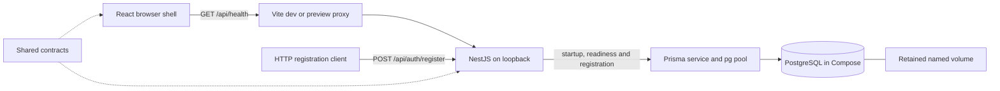

# Specification 0002: Current Project Context

Updated: 2026-10-24

Status: Current implemented-state overview after T01–T05, their reviews and verification. B02/M0 and the T05 registration API are complete. Update this document as later tasks change the architecture.

## 1. Purpose and document boundaries

Web Wargame is a browser service for the owner's group of friends to play a turn-based tabletop wargame. There is no current commercial launch plan. Favor low recurring cost, one host and straightforward maintenance. The owner is learning alongside development: explain important technical decisions in Russian while keeping repository documentation in English.

This document is the entry point for current technical context. [Specification 0001](0001-project-specification.md) retains the original requirements, proposed architecture and open gameplay questions. It is not evidence that all planned capabilities exist. The [product backlog](../product-backlog.md) defines feature scope; the [implementation backlog](../implementation-backlog.md) owns task status. [T01](0003-t01-workspace.md), [T02](0004-t02-local-database.md), [T03](0006-t03-repeatable-checks.md), [T04](0007-t04-local-workflow.md) and [T05](0008-t05-registration.md) describe individual increments. Reviews record findings; verification reports record checks actually performed.

## 2. Product scope and present state

| Capability | Present state |
| --- | --- |
| Browser shell and real server request | Implemented in T01. A Russian welcome page displays connection status and allows retry. |
| Local persistence and configuration | Implemented in T02: PostgreSQL, Prisma, migrations, private local settings, startup validation and readiness. |
| Repeatable checks and repository CI | Implemented and published in T03, including the reviewed runtime correction. Clean frozen installation and all local lint/type/build/test checks pass under Node 22.22.3. Remote CI status remains unverified after publication. |
| Documented local workflow | Completed in T04: clean-checkout setup, browser/API demonstration, normal Windows terminal stop/restart, built preview and retained database state were verified. |
| Player registration API | Implemented in T05: persisted users, normalized unique usernames, Argon2id password hashes, strict validation and bounded attempts/work. Always creates a player, without a session or game access. |
| Login/sessions and account forms | Planned, T06–T07. No login/session model or registration/login UI exists. |
| Administrator/player permissions | Planned, T08/T11/T17. No application permission system exists yet. |
| Illustrated rules and admin catalogs | Planned, T09–T16. No uploads, rules editor or catalog UI exists. |
| Shared board, unit inspection and movement | Planned, T18–T23/T28–T29. Konva is confirmed but not installed. |
| Admin and mutual-consent turn changes | Planned, T24–T27. The turn and voting rules still require input. |
| Damage/casualty calculator | Planned, T30–T32. No formulas or unit abilities are implemented. |
| Applying combat losses | Optional T39, outside the required calculator scope. |
| Production deployment and off-host backups | Planned, T35–T38. No production service has been deployed. |

T01–T05 and the foundation parent B02/M0 are Done. T04's runtime checks occurred on 2026-10-23; completion documentation was finalized on 2026-10-24. T05 was implemented/verified on 2026-10-24. Public registration and ASCII username policy are owner-confirmed; B03 still needs the T07 browser form. Login, content administration and gameplay are not implemented. Private games, two sides, voting freeze and the proposed 2–8-player capacity envelope remain assumptions rather than approved gameplay rules.

## 3. Stack and reasons

| Layer | Implemented choice | Reason and limitation |
| --- | --- | --- |
| Runtime | Node.js `^22.22.3` or `^24.15.0`; reference `.node-version` 22.22.3 | Corrected after the old 22.22.0 reference failed strict engine validation. Clean frozen installation and full checks passed with pnpm itself and child commands both on portable 22.22.3. All locked engine declarations accept the range; this is not a full execution matrix. The owner's system Node was not replaced. |
| Language | TypeScript 5.9.3, strict settings | Share types and eventually pure game logic. Runtime data/configuration still needs validation. |
| Workspace | pnpm 11.25.0, four private packages, committed lockfile | Local `workspace:*` links and ordered builds avoid separate package releases. No Nx/Turborepo is required. |
| Browser | React/React DOM 19.3.1, Vite 8.3.5, React plugin 6.1.2 | Stateful browser UI and development/build tooling without server rendering. Current scope is a single page. |
| API | NestJS 12.2.0, local CLI 12.0.10, Express adapter | One structured backend with lifecycle hooks and room for feature modules. No global CLI or second backend service is needed. |
| Database | Official PostgreSQL 18.6 bookworm image | Transactions and relational game/account data fit the future model. One local database avoids a managed-service bill. |
| Persistence tools | Prisma CLI/client/pg adapter 7.10.1 | Versioned migrations and generated ESM client. SQL probes work without introducing dummy domain models. PostgreSQL driver dependencies are pinned transitively by the lockfile. |
| Configuration | Zod 4.6.7 and Node's built-in environment loader | Validate required settings and report constraints without echoing credentials. No dotenv dependency is needed. |
| Password storage | `argon2` 0.45.1, Argon2id, 19 MiB/two iterations/parallelism one | Library-generated salt and 32-byte encoded hash; cap two concurrent registration hashes. Explicit native install permission; fresh Windows/Linux Node 22.22.3 installations and operations passed. No recurring service cost. Measure on the eventual host. |
| Styling | Plain CSS with shared semantic tokens and system fonts | Preserve the owner's approved style without a UI-kit subscription or external font service. |
| Current tests | Node's built-in test runner, real HTTP/PostgreSQL integration | 24 database-free configuration/startup/registration/hash/limiter tests; separate registration races, persistence and silent-network-failure checks without another test framework. |
| Static lint / CI | ESLint 10.13.0, `@eslint/js` 10.0.1, typescript-eslint 8.72.0, globals 17.13.0, React Hooks plugin 7.1.1; one GitHub Actions job | Exact development-only versions and committed lockfile. Recommended JS/TS correctness rules and fundamental Hooks checks; not a formatter or type-aware lint suite. CI consumes the corrected Node reference and has temporary PostgreSQL; no remote CI success yet. |

Confirmed future board technology: Konva/react-konva. Proposed future tools include React Router, React Hook Form, TanStack Query, rich-text editing and Socket.IO; introduce them with their actual feature and explain the decision. Vitest/Playwright remain possible later testing choices, not installed infrastructure. Server-side sessions remain a T06 proposal; Argon2id is implemented in T05. Redis, microservices, Kubernetes, paid monitoring, managed databases and object storage are not launch prerequisites. Local asset storage is planned, not implemented.

## 4. Architecture now

`apps/web` owns UI; `apps/api` owns configuration, HTTP, registration and database access; `packages/contracts` owns shared health/readiness and registration contracts; `packages/game-engine` is an empty buildable rules entry point. There is no browser-to-database connection. All code uses ESM; Node packages use `NodeNext`, while the browser uses bundler module resolution. Generated Prisma TypeScript lives under ignored `apps/api/src/generated/prisma` and is built into API output. The application factory installs a registration limiter before bounded JSON parsing and validates UTF-8 bytes before decoding; executable and integration tests share this setup.

The planned architecture is server-authoritative: future moves, votes and combat application must be checked and committed by the server. Sharing an engine with browser previews will not make browser results authoritative. Current code has no game command service, revisions, event log, sockets or authorization yet.

## 5. Interfaces and local operation

| Interface | Contract |
| --- | --- |
| `GET /api/health` | HTTP 200: `{ "status": "ok", "service": "wargame-api" }`. Process liveness only. |
| `GET /api/ready` | Queries the database; HTTP 200: `{ "status": "ready", "database": "ok" }`; HTTP 503 with a generic message when the query fails. |
| `POST /api/auth/register` | Strict JSON `{username,password}` → 201 with public player ID/name/role/timestamp. 400 field/JSON errors, 409 duplicate, 413 oversized, 415 unsupported media/encoding, 429 attempt limit with `Retry-After`, 503 capacity/persistence failure. No session cookie. Full [T05 contract](0008-t05-registration.md#api-contract). |
| Browser request | Relative `/api/health`, HTTP and runtime-body checks, five-second timeout, cleanup and retry. It does not currently display readiness. |

The API validates settings and successfully queries PostgreSQL before listening. Default loopback ports: API 3000, frontend development 5173, built preview 4173 and PostgreSQL 5432. `API_PORT` configures the API and Vite proxy target. Private database settings are not injected into frontend assets.

The root ignored `.env` is created by `pnpm env:init`; it contains a random local password. The initializer preserves an existing file. Existing process variables override file values. `.env.example` contains only names, nonsecret defaults and blank secret fields. `pnpm db:up` starts the database; `pnpm db:migrate` applies committed history; `pnpm dev` starts the applications/watchers. `pnpm db:down` independently stops the database project and retains its volume. Full commands and troubleshooting live in [README](../../README.md).

The named volume `webwargame-local_postgres-data` is mounted at `/var/lib/postgresql`. Its persistence was tested across container replacement; that is not a backup or disk-failure recovery guarantee. pnpm's separate shared dependency store is also outside the source tree; it is a package cache, not application data. Git tracks manifests/lockfile, not installed packages, generated code, local credentials or volumes.

T04 documents the complete first-setup/daily/update/preview workflow and optional second-checkout isolation with a stable `COMPOSE_PROJECT_NAME` plus matching published database/URL ports. An ordinary second directory is not database isolation. The optional `db:verify` utility currently fixes the default Compose project and must not be run against an isolated second-checkout setup. Its limitation is explicit in README; the default application/database behavior is unchanged.

## 6. Data, visual style and checks

The Prisma schema now contains `UserRole` (`PLAYER`, `ADMIN`) and `User`: database-generated UUID, display username, unique lowercase normalized username, encoded password hash, role defaulting to `PLAYER` and creation timestamp. T05's additive migration preserves the T02 baseline; both migrations are applied to the local project database. Registration always writes `PLAYER`; admin provisioning/guards remain T08. No session/game/unit/map table exists yet.

Owner-confirmed registration is public and accepts ASCII Latin letters/digits/`._-` usernames of 3–32 characters, trimmed for surrounding whitespace and case-insensitive for uniqueness. Passwords are 15–128 Unicode code points, with spaces retained and controls/malformed Unicode rejected; no trimming or normalization occurs. Attempt windows allow ten per socket address and 100 globally in 15 minutes; stored addresses and concurrent hashing are bounded. Proxy headers are ignored, so Vite/reverse-proxy users share a socket-address budget. Counters reset on restart and are scoped to one API instance; revisit proxy trust/distribution before deployment changes. See [T05 decisions](0008-t05-registration.md).

The owner-approved UI uses deep green `#172724`, surface green `#1d302b`, ivory `#f5f0e5`, muted green-grey `#c1cec7` and sand/gold `#d6b67a`. Reuse CSS tokens, serif display headings, system UI fonts, restrained borders and rounded panels. See the [style guide](../design/interface-style.md) for the complete palette, responsive layout and component rules. Do not recolor uploaded maps/unit art to match the UI.

Foundation verification included frozen installation, type/build checks, ten configuration/startup/local-target tests, one database-network integration test, migration status and opt-in persistence checks. See [T01 evidence](../verification/t01-workspace.md), [T02 evidence](../verification/t02-local-database.md) and the [combined code review](../reviews/0003-t01-t02-code-review.md). T05's larger current suite is recorded below. No CI success, production readiness or complete accessibility matrix is claimed.

T03 adds `pnpm lint`, `pnpm test` (the existing configuration suite; build first when run alone) and `pnpm check` (lint → typecheck → build → test). `check` needs neither `.env` nor a running database. It passed in both the main checkout and an isolated credential-free source copy with a separate frozen cached installation. A temporary intentional `string`-to-`number` assignment in that copy made root type checking exit 1 with TS2322; the restored copy passed. See [T03 evidence](../verification/t03-repeatable-checks.md).

T04 repeated the documented workflow in a clean Git clone with both pnpm and its child commands using Node 22.22.3. Cached frozen installation, migrations, root checks/ten tests, browser retry, direct/proxied health and readiness, compiled preview and bounded startup failures passed. Two owner-operated PowerShell development cycles each reached readiness, then Ctrl+C and `Y` left no captured process or listener on ports 3000/5173; no forced cleanup was needed. This closes the earlier normal-terminal verification gap without changing process orchestration. Isolated PostgreSQL stop/start replaced the container while retaining the exact migration record; readiness recovered without restarting the API, and the main database remained separate. See [T04 evidence](../verification/t04-local-workflow.md) for the dated results and limits.

[Review 0004](../reviews/0004-t03-code-review.md), dated 2026-10-23, reproduced the old Node 22.22.0 frozen-install failure and identified why pnpm's separate bundled runtime had masked it locally. The same-day correction raised the reference to 22.22.3 and narrowed supported ranges to match locked dependencies. A new source-only copy with no `.env` or installed dependencies passed frozen installation as its first dependency operation, retained the exact lockfile hash and passed all root checks with ten tests. The child Node and pnpm host runtime were both explicitly verified as 22.22.3. An independent engine audit and fix review found no remaining actionable issue; T03 completion is restored. See [correction evidence](../verification/t03-repeatable-checks.md#6-runtime-review-correction--2026-10-23). After the owner restarted Docker on 2026-10-23, final pre-publication checks under that selected runtime also passed the root suite, clean/idempotent migrations, migration status and one real network-failure test in an isolated local database. The test database was removed and the project schema remained current; [the new evidence](../verification/t03-repeatable-checks.md#7-final-pre-publication-postgresql-check--2026-10-23) is separate from earlier checks.

The [CI workflow](../../.github/workflows/ci.yml) runs the same checks on pushes, pull requests and manual dispatch, then applies migrations twice, inspects migration status and runs the real network-failure test against its own PostgreSQL service. It reads Node/pnpm versions from the repository, uses frozen installation, full action commit SHAs, minimal repository permissions, a timeout and stale-run cancellation. It neither uses production secrets nor deploys. T03 was published to `origin/master` as `f4782e3` with the owner's authorization; an exact-SHA Actions API read returned HTTP 404 without additional account access, so remote CI status remains unverified. See [publication evidence](../verification/t03-repeatable-checks.md#8-owner-authorized-publication--2026-10-23). Docker's Inference manager/socket failure blocked the initial T03 database pass. The owner's same-day retry restored the runtime by preserving its socket-only directory and launching Desktop through the Windows shell; clean/idempotent migrations, status and the real network-failure test then passed against an isolated local database. That temporary database was removed, and the project service remained healthy with current migration history. No reset or image/volume/VM-data deletion was performed; container-replacement persistence was not rerun. Details and recovery limits are in [T03 evidence](../verification/t03-repeatable-checks.md#5-postgresql-retry-and-runtime-recovery--2026-10-22).

T05 extends root `test`/`check` with fourteen registration/hash/limiter tests, bringing the database-free total to 24. After [Review 0006](../reviews/0006-t05-code-review.md), `test:database` runs eleven real HTTP registration scenarios plus the existing readiness network test (thirteen reported Node cases including the registration parent). The runner creates/migrates/drops only its own random loopback database and requires a local/CI database role with create/drop permission. Fresh credential-free Windows and Linux x64 sources passed frozen installation and the full root suite under Node 22.22.3/pnpm 11.25.0 before the review correction; the final Windows root/database suites passed after it. Real PostgreSQL checks confirmed restart persistence, one winner under concurrent normalized duplicates, no injected roles/hash leakage, bounded parsing, strict raw UTF-8 and spoof-resistant attempt limits. Main local migration deploy/reapply/status passed. See [T05 evidence](../verification/t05-registration.md). CI is configured to run these tests; no new remote CI success, production-host measurement or browser form is claimed.

## 7. Constraints and next decisions

- Resolve Q01–Q06 before rule-dependent movement/turn/combat completion: written rules, representative units/maps, geometry, ownership, visibility, turn semantics, voting and worked combat examples.
- Resolve UI language/device expectations with Q08; Russian shell copy does not close that decision.
- Q07 registration policy is resolved in T05; resolve session lifetime before T06 and rules visibility before T14. Q08 still blocks final account UI expectations.
- Confirm monthly budget, group size, host and off-host backup destination before deployment; no provider has been selected or paid service authorized.

Maintain this overview with each completed increment, the incremental specification with behavior changes, and the task-status register with linked evidence. Historical reviews/reports remain historical; record follow-up corrections explicitly instead of rewriting past checks as if they were rerun.

## 8. Mandatory documentation maintenance

The owner requires a change specification and an update to this general context after every coherent change. Follow [Specification 0005](0005-development-documentation.md): create a numbered specification for each new task/change, update it through implementation/review, document actual verification, and link it from task completion evidence. Features, fixes, refactors, configuration/dependency/tooling and development-policy changes are included. A task cannot be Done with a missing/stale specification or context; include documentation with source changes when committing.

Latest update (2026-10-24): [T05](0008-t05-registration.md) implements player registration, its schema migration, password storage, request limits and tests. [New evidence](../verification/t05-registration.md) covers fresh Windows/Linux frozen checks, real registration/race/network tests and local schema deployment. Context, README and backlogs now distinguish the completed API from future account forms/sessions. Approved interface style is unchanged; T03 publication and unavailable remote CI evidence remain separately recorded. [Specification 0005](0005-development-documentation.md) continues to govern documentation maintenance.

The owner-requested [T05 review](../reviews/0006-t05-code-review.md) found and corrected one P2 decoding defect: invalid UTF-8 could be replaced before password validation. Raw-byte verification now rejects it and other charsets. Post-correction root/database checks passed; no unresolved review finding remains. The existing T05 specification/evidence include the correction, and commit/push is owner-authorized after final verification. No schema/dependency change or deployment is added by the correction.

The same-day owner-requested [T04 code/documentation review](../reviews/0005-t04-code-documentation-review.md) found no actionable defect in the changed instructions, related code or recorded acceptance evidence. It adds a review report/navigation and checks documentation links without rerunning the historical runtime suite. T04/B02/M0 remain Done; application behavior is unchanged.
