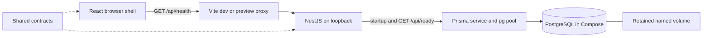

# Specification 0002: Current Project Context

Updated: 2026-10-22

Status: Current implemented-state overview after T01, T02 and their code review. Update this document as later tasks change the architecture.

## 1. Purpose and document boundaries

Web Wargame is a browser service for the owner's group of friends to play a turn-based tabletop wargame. There is no current commercial launch plan. Favor low recurring cost, one host and straightforward maintenance. The owner is learning alongside development: explain important technical decisions in Russian while keeping repository documentation in English.

This document is the entry point for current technical context. [Specification 0001](0001-project-specification.md) retains the original requirements, proposed architecture and open gameplay questions. It is not evidence that all planned capabilities exist. The [product backlog](../product-backlog.md) defines feature scope; the [implementation backlog](../implementation-backlog.md) owns task status. [T01](0003-t01-workspace.md) and [T02](0004-t02-local-database.md) describe individual implementation increments. Reviews record findings; verification reports record checks actually performed.

## 2. Product scope and present state

| Capability | Present state |
| --- | --- |
| Browser shell and real server request | Implemented in T01. A Russian welcome page displays connection status and allows retry. |
| Local persistence and configuration | Implemented in T02: PostgreSQL, Prisma, migrations, private local settings, startup validation and readiness. |
| Username/password registration and sessions | Planned, T05–T07. No user model or authentication exists. |
| Administrator/player permissions | Planned, T08/T11/T17. No application permission system exists yet. |
| Illustrated rules and admin catalogs | Planned, T09–T16. No uploads, rules editor or catalog UI exists. |
| Shared board, unit inspection and movement | Planned, T18–T23/T28–T29. Konva is confirmed but not installed. |
| Admin and mutual-consent turn changes | Planned, T24–T27. The turn and voting rules still require input. |
| Damage/casualty calculator | Planned, T30–T32. No formulas or unit abilities are implemented. |
| Applying combat losses | Optional T39, outside the required calculator scope. |
| Production deployment and off-host backups | Planned, T35–T38. No production service has been deployed. |

T01 and T02 are Done; B02/M0 are not complete until T03 (repeatable checks/CI) and T04 (complete local workflow) are finished. Private games, two sides, voting freeze and the proposed 2–8-player capacity envelope remain assumptions rather than approved gameplay rules.

## 3. Stack and reasons

| Layer | Implemented choice | Reason and limitation |
| --- | --- | --- |
| Runtime | Node.js `^22.13.0` or `^24.0.0`; reference `.node-version` 22.22.0 | Supported compatible runtime lines. Verification used the shell's Node 22.22.0 and the installed pnpm's bundled Node 24 runtime; not a full compatibility matrix. |
| Language | TypeScript 5.9.3, strict settings | Share types and eventually pure game logic. Runtime data/configuration still needs validation. |
| Workspace | pnpm 11.25.0, four private packages, committed lockfile | Local `workspace:*` links and ordered builds avoid separate package releases. No Nx/Turborepo is required. |
| Browser | React/React DOM 19.3.1, Vite 8.3.5, React plugin 6.1.2 | Stateful browser UI and development/build tooling without server rendering. Current scope is a single page. |
| API | NestJS 12.2.0, local CLI 12.0.10, Express adapter | One structured backend with lifecycle hooks and room for feature modules. No global CLI or second backend service is needed. |
| Database | Official PostgreSQL 18.6 bookworm image | Transactions and relational game/account data fit the future model. One local database avoids a managed-service bill. |
| Persistence tools | Prisma CLI/client/pg adapter 7.10.1 | Versioned migrations and generated ESM client. SQL probes work without introducing dummy domain models. PostgreSQL driver dependencies are pinned transitively by the lockfile. |
| Configuration | Zod 4.6.7 and Node's built-in environment loader | Validate required settings and report constraints without echoing credentials. No dotenv dependency is needed. |
| Styling | Plain CSS with shared semantic tokens and system fonts | Preserve the owner's approved style without a UI-kit subscription or external font service. |
| Current tests | Node's built-in test runner, HTTP smoke checks, real local PostgreSQL integration | Meaningful configuration, startup, persistence and silent-network-failure checks without another test framework. |

Confirmed future board technology: Konva/react-konva. Proposed future tools include React Router, React Hook Form, TanStack Query, rich-text editing and Socket.IO; introduce them with their actual feature and explain the decision. Vitest/Playwright remain possible later testing choices, not installed infrastructure. Server-side sessions and Argon2id remain identity proposals until those tasks are implemented. Redis, microservices, Kubernetes, paid monitoring, managed databases and object storage are not launch prerequisites. Local asset storage is planned, not implemented.

## 4. Architecture now

`apps/web` owns UI; `apps/api` owns configuration, HTTP and database access; `packages/contracts` owns shared health/readiness contracts; `packages/game-engine` is an empty buildable rules entry point. There is no browser-to-database connection. All code uses ESM; Node packages use `NodeNext`, while the browser uses bundler module resolution. Generated Prisma TypeScript lives under ignored `apps/api/src/generated/prisma` and is built into API output.

The planned architecture is server-authoritative: future moves, votes and combat application must be checked and committed by the server. Sharing an engine with browser previews will not make browser results authoritative. Current code has no game command service, revisions, event log, sockets or authorization yet.

## 5. Interfaces and local operation

| Interface | Contract |
| --- | --- |
| `GET /api/health` | HTTP 200: `{ "status": "ok", "service": "wargame-api" }`. Process liveness only. |
| `GET /api/ready` | Queries the database; HTTP 200: `{ "status": "ready", "database": "ok" }`; HTTP 503 with a generic message when the query fails. |
| Browser request | Relative `/api/health`, HTTP and runtime-body checks, five-second timeout, cleanup and retry. It does not currently display readiness. |

The API validates settings and successfully queries PostgreSQL before listening. Default loopback ports: API 3000, frontend development 5173, built preview 4173 and PostgreSQL 5432. `API_PORT` configures the API and Vite proxy target. Private database settings are not injected into frontend assets.

The root ignored `.env` is created by `pnpm env:init`; it contains a random local password. The initializer preserves an existing file. Existing process variables override file values. `.env.example` contains only names, nonsecret defaults and blank secret fields. `pnpm db:up` starts the database; `pnpm db:migrate` applies committed history; `pnpm dev` starts the applications/watchers. `pnpm db:down` independently stops the database project and retains its volume. Full commands and troubleshooting live in [README](../../README.md).

The named volume `webwargame-local_postgres-data` is mounted at `/var/lib/postgresql`. Its persistence was tested across container replacement; that is not a backup or disk-failure recovery guarantee. pnpm's separate shared dependency store is also outside the source tree; it is a package cache, not application data. Git tracks manifests/lockfile, not installed packages, generated code, local credentials or volumes.

## 6. Data, visual style and checks

The current Prisma schema contains a generator and PostgreSQL datasource, with no domain models. The baseline ensures `public` exists and establishes `_prisma_migrations`. User, session, game, unit and map tables must be introduced with their corresponding feature requirements and migrations.

The owner-approved UI uses deep green `#172724`, surface green `#1d302b`, ivory `#f5f0e5`, muted green-grey `#c1cec7` and sand/gold `#d6b67a`. Reuse CSS tokens, serif display headings, system UI fonts, restrained borders and rounded panels. See the [style guide](../design/interface-style.md) for the complete palette, responsive layout and component rules. Do not recolor uploaded maps/unit art to match the UI.

Current verification includes frozen installation, type/build checks, 10 configuration/startup/local-target tests, one database-network integration test, migration status and opt-in persistence checks. See [T01 evidence](../verification/t01-workspace.md), [T02 evidence](../verification/t02-local-database.md) and the [combined code review](../reviews/0003-t01-t02-code-review.md). No CI success, production readiness or complete accessibility matrix is claimed.

## 7. Constraints and next decisions

- Resolve Q01–Q06 before rule-dependent movement/turn/combat completion: written rules, representative units/maps, geometry, ownership, visibility, turn semantics, voting and worked combat examples.
- Resolve UI language/device expectations with Q08; Russian shell copy does not close that decision.
- Resolve account access/session policy with Q07 before identity implementation.
- Confirm monthly budget, group size, host and off-host backup destination before deployment; no provider has been selected or paid service authorized.
- T04 must verify full development child-process shutdown/restart in the owner's Windows terminal. Earlier automation left watchers behind; this is an open verification gap.

Maintain this overview with each completed increment, the incremental specification with behavior changes, and the task-status register with linked evidence. Historical reviews/reports remain historical; record follow-up corrections explicitly instead of rewriting past checks as if they were rerun.

## 8. Mandatory documentation maintenance

The owner requires a change specification and an update to this general context after every coherent change. Follow [Specification 0005](0005-development-documentation.md): create a numbered specification for each new task/change, update it through implementation/review, document actual verification, and link it from task completion evidence. Features, fixes, refactors, configuration/dependency/tooling and development-policy changes are included. A task cannot be Done with a missing/stale specification or context; include documentation with source changes when committing.

Latest maintenance update (2026-10-22): Specification 0005 makes this workflow mandatory and aligns repository instructions and both backlog completion rules. This increment changes development documentation only; the T01–T02 application, stack, API, database and approved visual style remain as described above.
